# Exercise 1 - Provision SAP BDC Connect and include Enterprise Snowflake in a SAP BDC Formation

> [!IMPORTANT]
> This is only a **read-only** exercise, since sharing provisioning SAP BDC Connect in SAP Business Data Cloud requires ADMIN rights. The purpose is to illustrate how to include Enterprise Snowflake into an SAP BDC Formation using the SAP BDC Connect component. There is a product guided tour available below. The Read-only part of the blog is based on a SAP Community Blog which can be found [here](https://community.sap.com/t5/technology-blog-posts-by-sap/provisioning-of-sap-bdc-connect-for-snowflake/ba-p/14481139)

## Pre-requisites
- Access to SAP for Me (me.sap.com) with the appropriate authorizations.
- SAP Business Data Cloud Core must be enabled.
- Sufficient remaining capacity units in your contract to allocate to the new solution.
- The Snowflake account must be Standard, Enterprise, or Business Critical edition. You should be ORGADMIN to accept the SAP® BDC Connect for Snowflake Terms or the ORGADMIN must accept the terms before to star the provisioning process.
- You need to have the role ACCOUNTADMIN or need to have the proper roles and privileges in Snowflake to create the connector.

#### Guided Tour
Use the clickthrough below to get an impression of provisioning SAP® BDC Connect for Snowflake and adding Snowflake into an SAP BDC Formation. Click the button below to launch the interactive prototype.

## Provisioning Guide (READ-ONLY)

1. Log in to SAP for Me and navigate to Portfolio & Products > Business Data Cloud. On the Applications tab you will find SAP Business Data Cloud Connect. Click on "Start Provisioning".
 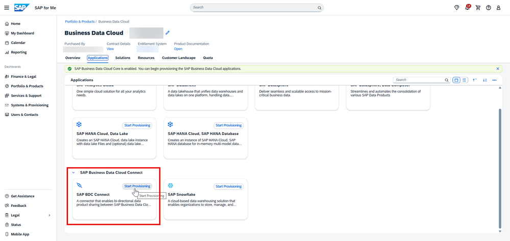

2. In the "Business Data Cloud - Create Solution" dialog that appears, provide details such as Solution Name (you can edit it later), Path (select the same resource group you selected for the BDC Cockpit) and Business Type (by default is 'Production’). Click on "Next Step".
 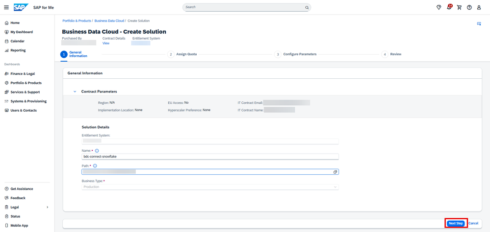

3. On the Assign Quota page, specify the planned Capacity Units (CU) for SAP BDC Connect. You can use the [SAP Business Data Cloud Capacity Unit Estimator](https://datasphere-estimator-sac-sacus10.cfapps.us10.hana.ondemand.com) to check the appropriate number that you need. Then click on “Next Step”.
 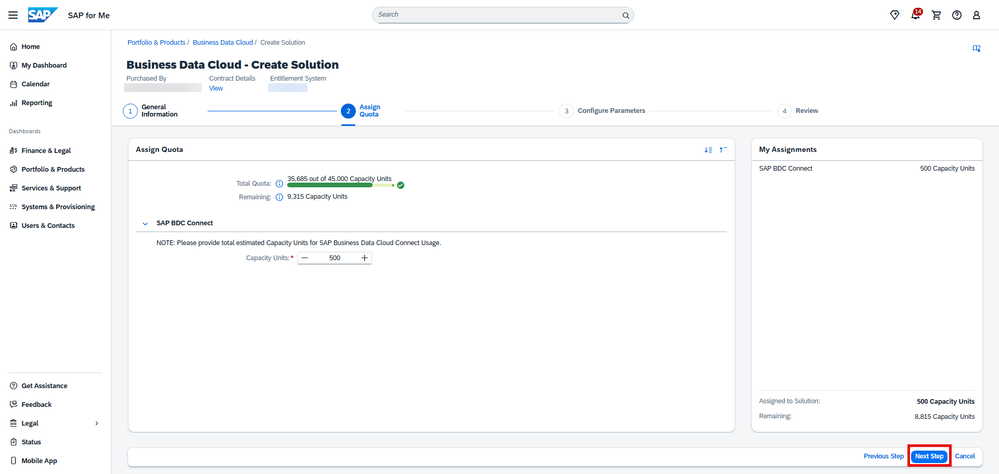

4. Log in to Snowflake and go to Ingestion > Zero-Copy, look for SAP® BDC Connect for Snowflake and click on "Connect".
 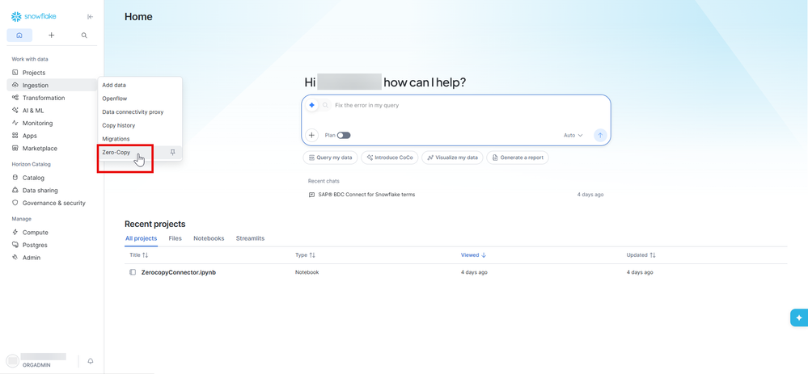

5. If you've not accepted the SAP® BDC Connect for Snowflake Terms please click on "View Terms". Then click on "Review" and click on "Accept". You must have the ORGADMIN role.
 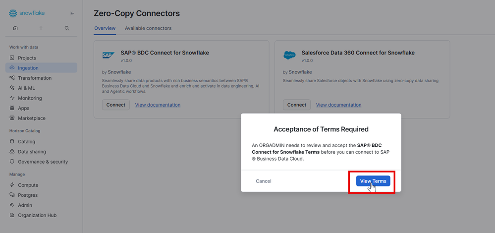
 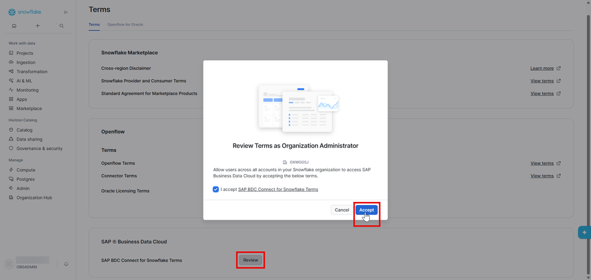

6. If you've already accepted the SAP® BDC Connect for Snowflake Terms. Then provide the Connector name and the Target Database and Schema where the connector will be installed, if you don't have a database you can create a new one in this step. Then click on "Create connector".
 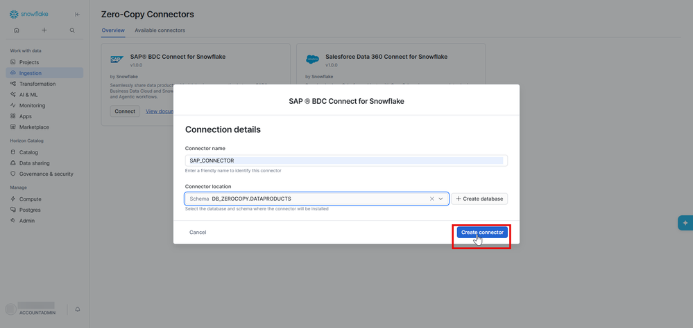

7. Copy the Unique Connector Identifier it is your Snowflake account URL: https://<orgName>-<accountName>.snowflakecomputing.com.
 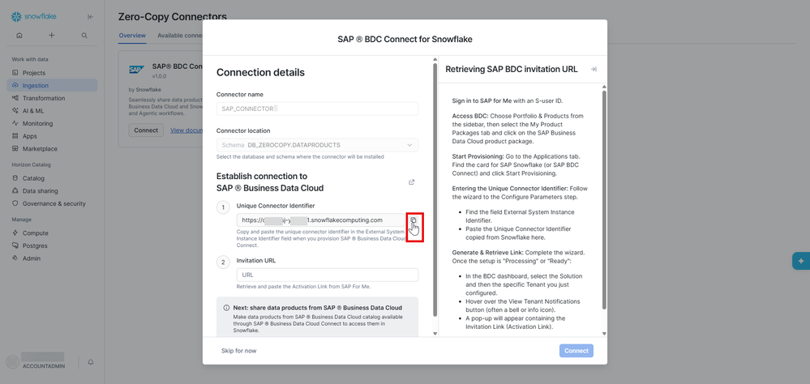

8. Go back to SAP for Me portal. On the Configure Parameters page provide the "External System Instance Identifier". Enter your Snowflake account that you copy in the previous step. Then select the same region as you selected for the BDC Cockpit and click on "Review".
 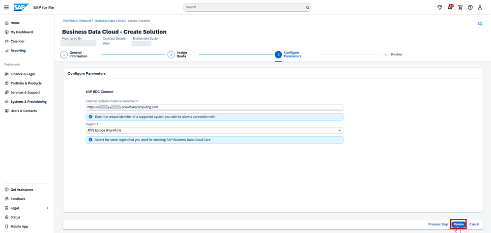

9. The final Review page presents a consolidated summary of all configuration choices made across the previous steps. Verify each section carefully. Once satisfied then click on "Finish" to submit the provisioning request. 
 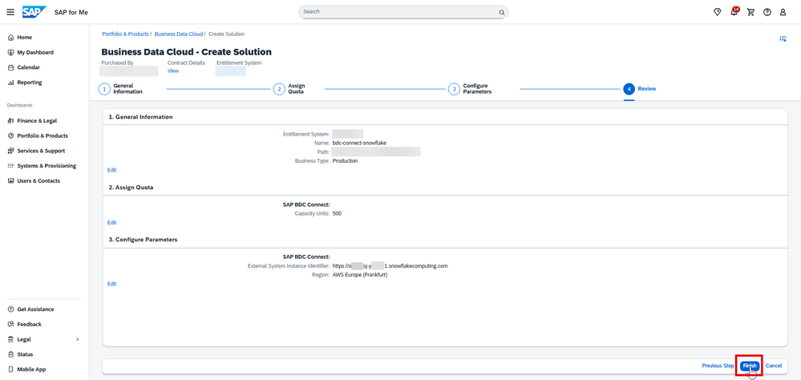

10. A confirmation message notifies you that the system is now creating the solution. Choose "View in Resources" to view the tenant in the resource group you have indicated.
 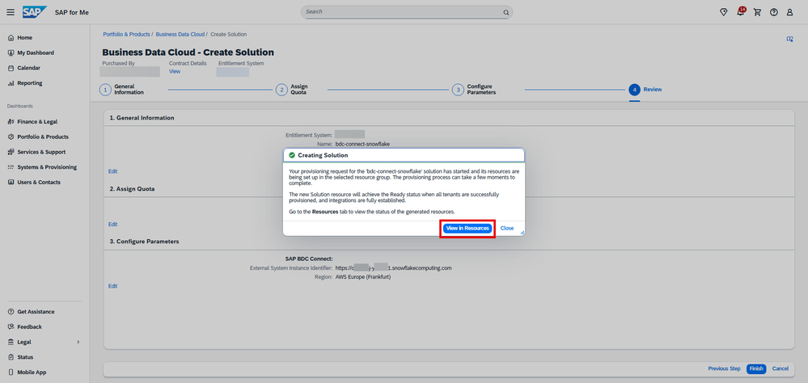

11. Wait a few minutes, and you will see a notification message for your SAP BDC Connect. Click on it to check the details, then copy the link provided. 
 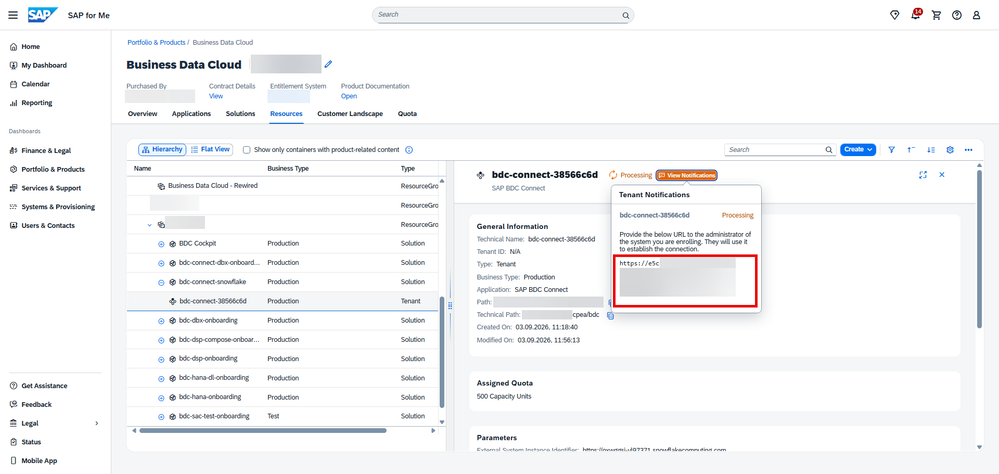

12. Go back to Snowflake and paste the Activation Link from SAP for Me. Then click on "Connect".
 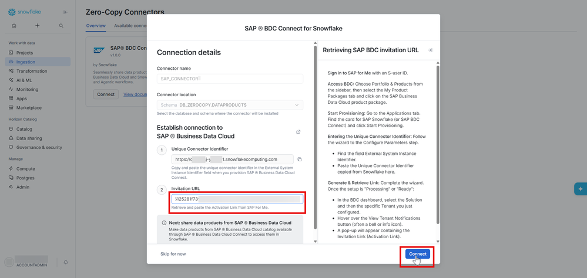

13. Now, your connector is ready in both sides Snowflake and SAP for Me.
 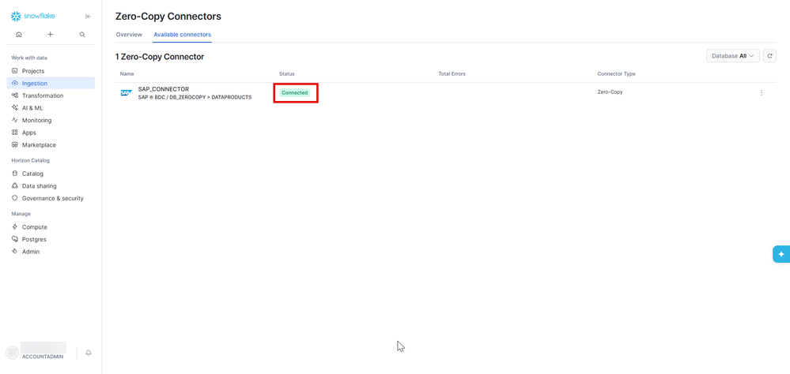
 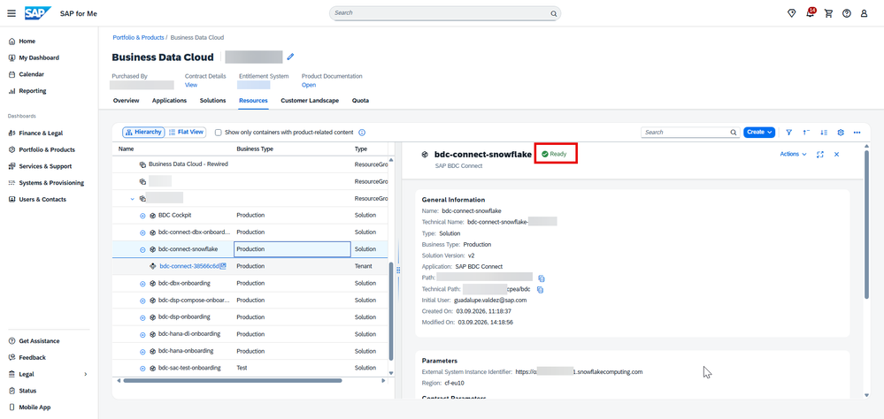

14. The final step to start sharing data products is that you need to come back to SAP for Me and add this new BDC connect instance to a SAP BDC formation. Then you can open you BDC Cockpit and share data products.
 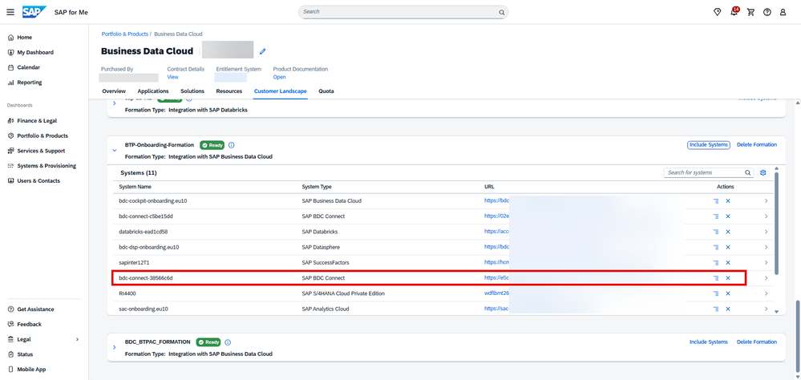

## Summary

You've now learnt how the ecosystem of SAP BDC can be enriched using the SAP BDC Connect Component.

Continue to the - [Exercise 2 - Share SAP-managed Data products from SAP BDC Catalog to Snowflake Horizon Catalog](../ex2/README.md) where you will learn how to share data products to Snowflake from the SAP BDC Catalog.