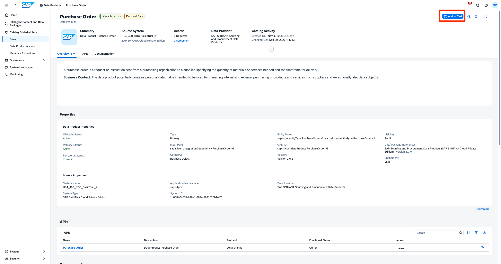
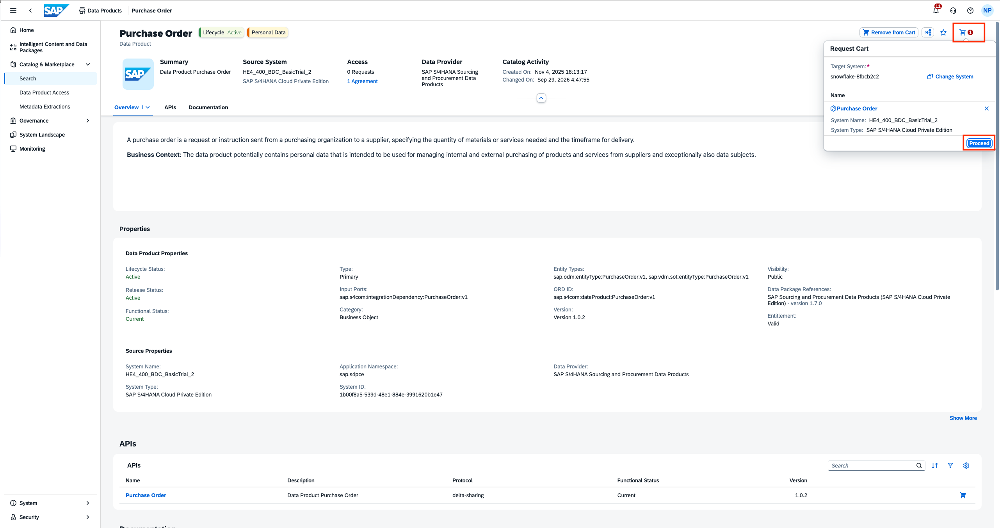
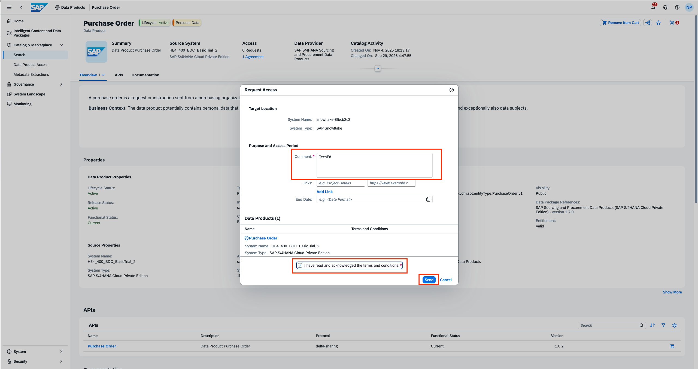
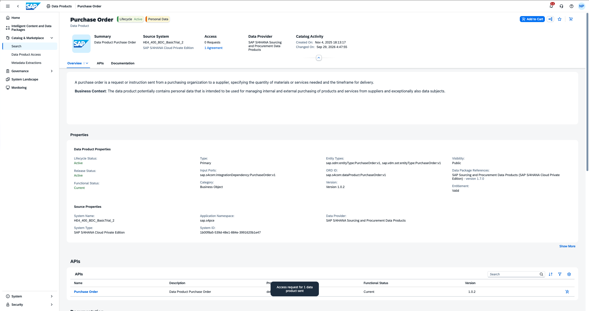
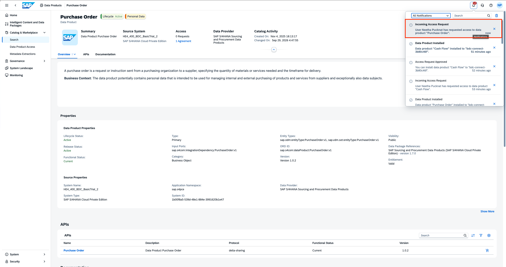
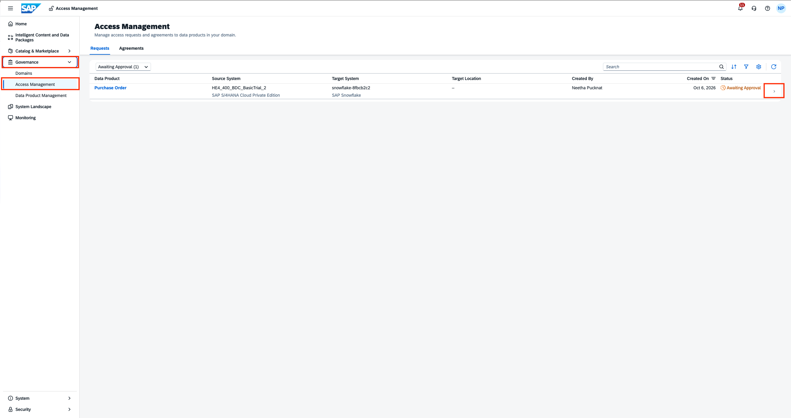
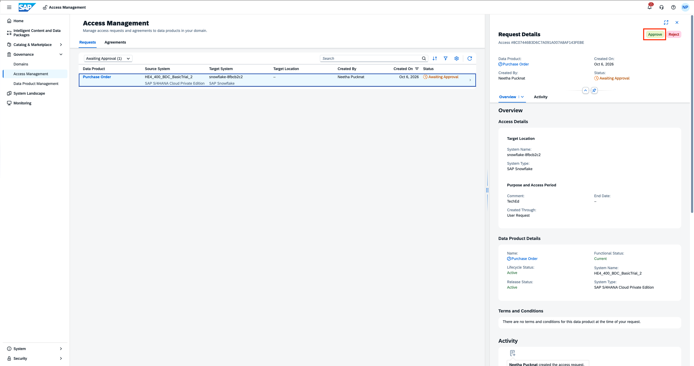
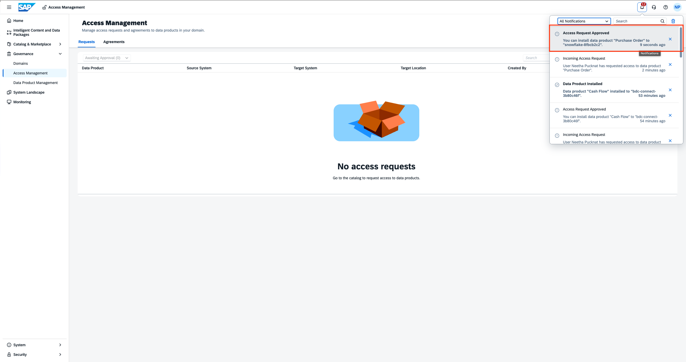
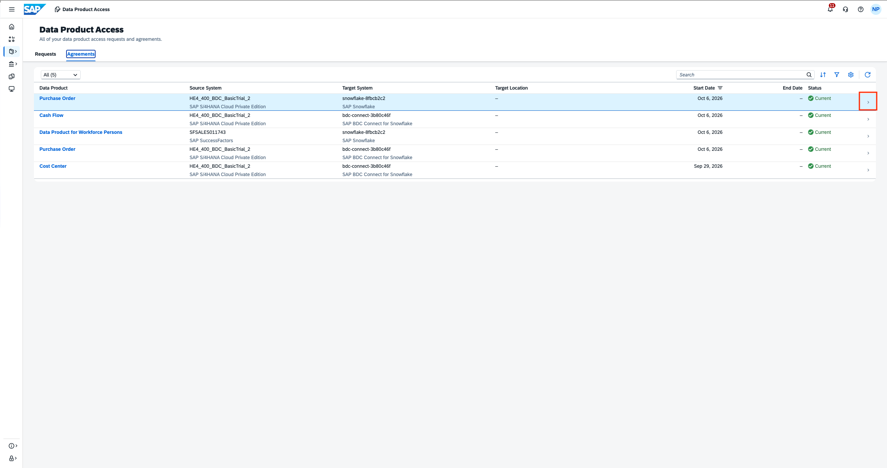
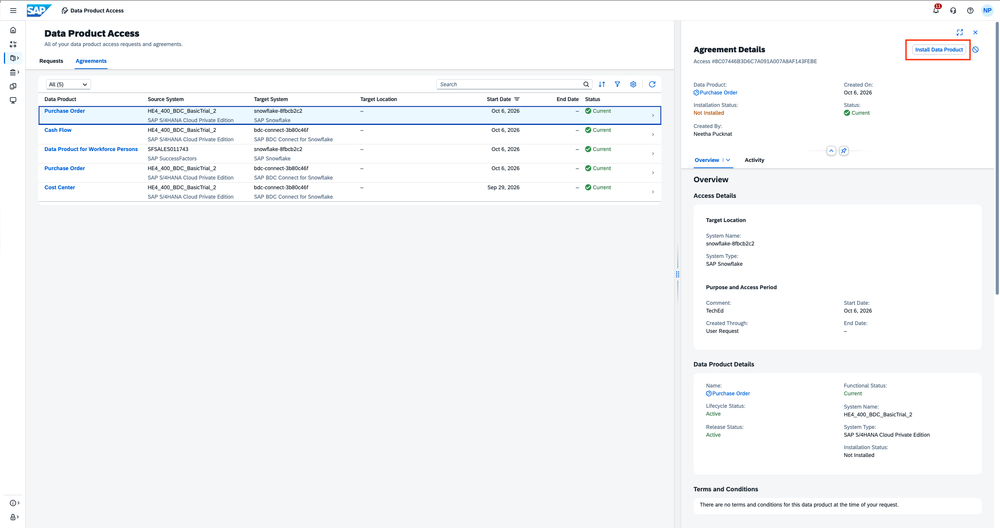

# Exercise 2 - READ-ONLY, GUIDED TOUR: Install SAP-managed Data products into SAP Snowflake Horizon Catalog

> [!IMPORTANT]
> This is only a **read-only** exercise, since installing data products from SAP Business Data Cloud into the Snowflake horizon catalog is a one-time activity. The purpose is to illustrate the zero-copy data sharing principle, to get easy access to SAP managed and standardized data product economy. There is a product guided tour available below.

This chapter describes the steps how Data Products in SAP Business Data Cloud (SAP BDC) are installed into Enterprise Snowflake using SAP BDC Connect. To include Snowflake in a SAP BDC Formation, SAP BDC Connect must be provisioned as a pre-requisite. We learned about this in the previous exercise.

In this exercise, we will learn about how to have consumption-ready SAP Managed Data products in Snowflake using SAP BDC Connect.

#### Prequisites
- You have an BDC system landscape formation with **SAP S/4HANA Private Cloud Edition**. 
- Following Data Products are already installed and available in the SAP Business Data Cloud catalog:

| Data Package | Data Product |
|---|---|
| SAP Sourcing and Procurement Data Products | PurchaseOrder |

#### Guided Tour
1. Use the Clickthrough below to get an impression of Installing data product from SAP BDC Catalog into SAP Snowflake. 

2. Use the clickthrough below to get an impression of mounting data product tables on Snowflake

#### Exercise (READ-ONLY)
##### Install data products from SAP BDC Catalog into Snowflake catalog: Create Access Request by Analyst role
For the mentioned data product above, install it to Enterprise Snowflake by following the steps below.
1. Open **Catalog & Marketplace** > **Search** and search the name of the data product.
 

2. Open the data product to be installed and click on **Add to Cart**.
 

3. Select the target system where you want to install the data product. Click on **Add to Cart**.
 

4. Click on the cart and then click **Proceed**.
 

5. Add a comment for the Adminstrator/ Data Steward. Then accept the **Terms and Conditions**. Click on **Send** to create and send the Access request.
 
 

##### Install data products from SAP BDC Catalog into Snowflake catalog: Approve Access Request by Data steward/Administrator role
1. Administrator/ Data Steward receives a notification for the access request.
 

2. The access request can be viewed either by clicking on the notification or can be viewed under **Governance > Access Management**
 

3. The request can be approved or rejected as per policy by the Administration or Data Steward.
 

4. An approval comment can be added and then click on **Approve**.
 

> [!IMPORTANT]
> For non-sensitive, low-fedelity data products, an Administrator or Data Steward could set up an Auto-approval access policy.

##### Install data products from SAP BDC Catalog into SAP Snowflake catalog: Finish Install by Requester
1. The request recives a notification that the access request has been approved.
 

2. Notification can be viewed or the approval can also be accessed under  **Catalog > Data Product Access**.
 

3. Click on **Install Data Product** to finish the installation into Snowflake.
 

##### Create catalog-linked databases for the zero-copy shared data products in Snowflake
1. Open Snowflake from the **System Landscape** tab.

2. Select **Ingestion** tab to view the shared data products from SAP BDC Catalog
 

3. Select **Zero-Copy** tab since the data is shared without replication
 

4. Select **Available connectors** to find the zero copy BDC Connector
 

5. Select the zero copy connector which has been created during setup.
 

6. Mount the shared data tables that were shared from the SAP BDC Catalog.
 

7. Once mounted, the data products are ready for consumption in Snowflake.
 

8. You can view the mounted databases in the Horizon catalog.
 

## Summary

You've now learnt how to install data products into Snowflake and mount data tables. Let us now continue to [Exercise 3 - Consume SAP-managed Data product in Enterprise Snowflake](../ex3/README.md)

