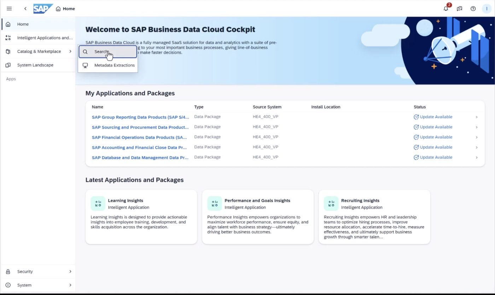
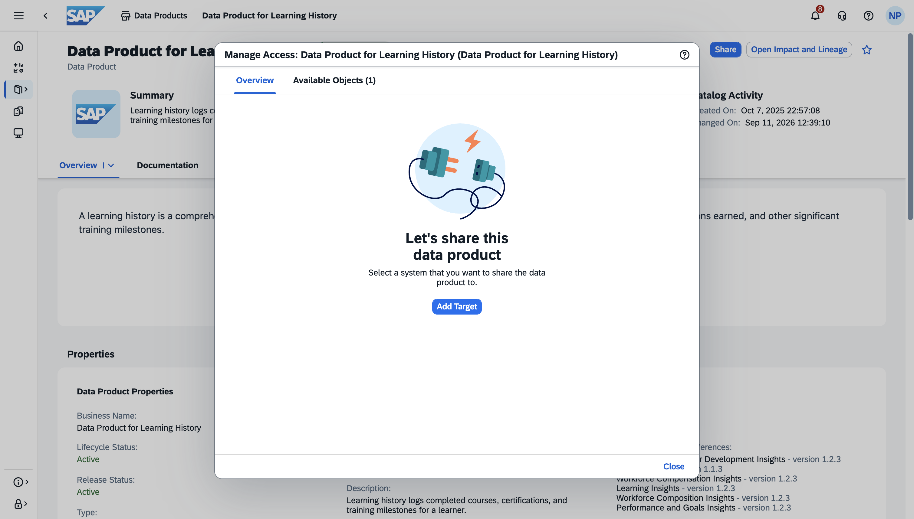
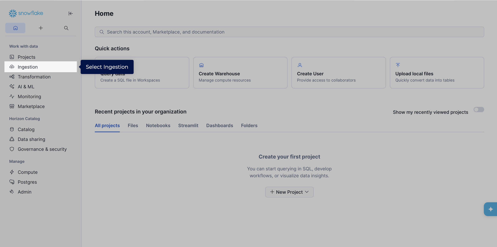
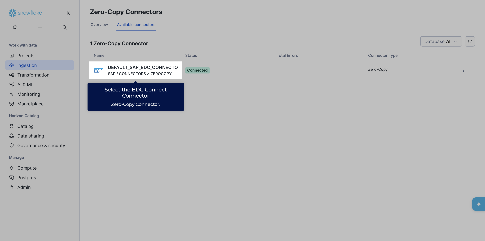
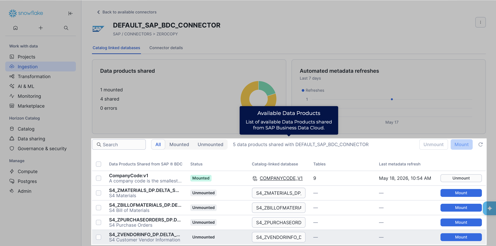

# Exercise 2 - READ-ONLY, GUIDED TOUR: Share SAP-managed Data products from SAP BDC Catalog to Snowflake Horizon Catalog

> [!IMPORTANT]
> This is only a **read-only** exercise, since sharing data products in SAP Business Data Cloud requires ADMIN rights. The purpose is to illustrate the zero-copy data sharing principle, to get easy access to SAP managed and standardized data product economy. There is a product guided tour available below.

This chapter describes the steps how Data Products in SAP Business Data Cloud (SAP BDC) are shared with Enterprise Snowflake using SAP BDC Connect. To include Snowflake in a SAP BDC Formation, SAP BDC Connect must be provisioned as a pre-requisite. We learned about this in the previous exercise.

In this exercise, we will learn about how to have consumption-ready SAP Managed Data products in Snowflake using SAP BDC Connect.

#### Prequisites
- You have an BDC system landscape formation with **SAP S/4HANA Private Cloud Edition**. 
- You need to have a SAP BDC Admin role for sharing
- Following Data Products are already installed and available in the SAP Business Data Cloud catalog:

| # | Data Package | Data Product |
|---|---|---|
| 1 | SAP S/4HANA Database and​ Data Management Data | Customer |
| 2 | SAP S/4HANA Sales Data Products | Billing Document |
| 3 | SAP S/4HANA Sales Data Products | Sales Order​ |

#### Guided Tour
1. Use the clickthrough below to get an impression of sharing data products to Snowflake using SAP BDC Connect. Click the button below to launch the interactive prototype.

2. Use the clickthrough below to get an impression of mounting data product tables on Snowflake

#### Exercise (READ-ONLY)
##### Share data products from SAP BDC Catalog to Snowflake catalog
For the mentioned nine data products, share each of the data products to Snowflake by following the steps below for each of them.
1. Login to SAP Business Data Cloud Cockpit and click on `Search` to navigate to the Data Catalog.
 

2. In the catalog search view, click the Data Products tab in the filter bar to narrow the results to data products only.
 

3. Search for the data product by name and using the filters.
 

4. View the details of the data product. Then, use **Share** button and add target to share with. 
 

5. In this case, our desired target is Snowflake.
 

6. Create the share using the Share button
 

##### Create catalog-linked databases for the zero-copy shared data products in Snowflake
1. Open Snowflake from the **System Landscape** tab.

2. Select **Ingestion** tab to view the shared data products from SAP BDC Catalog
 

3. Select **Zero-Copy** tab since the data is shared without replication
 

4. Select **Available connectors** to find the zero copy BDC Connector
 

5. Select the zero copy connector which has been created during setup.
 

6. Mount the shared data tables that were shared from the SAP BDC Catalog.
 

7. Once mounted, the data products are ready for consumption in Snowflake.
 

8. You can view the mounted databases in the Horizon catalog.
 

## Summary

You've now learnt how to share data products to Snowflake and mount data tables. Let us now continue to [Exercise 3 - Consume SAP-managed Data product in Enterprise Snowflake](../ex3/README.md)

