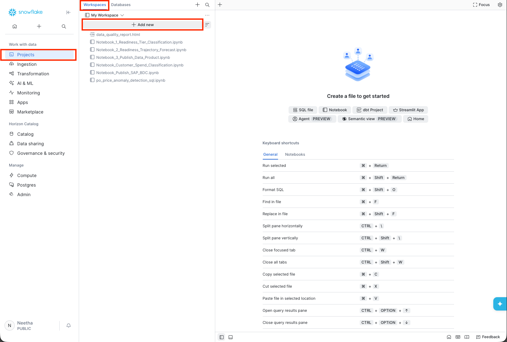

# Exercise 3 - HANDS-ON: Consume SAP-managed Data product in Enterprise Snowflake (Purchase Order Price Anomaly Detection)

In this exercise, we will learn how to run simple ML workflows in Snowflake. Open Snowflake which is included in our SAP BDC Formation. Here is the [Snowflake tenant](TODO).
In Snowflake, upload the notebook provided as shown in the image below:

 

In the notebook, when you see a ✍️ icon, please pay attention and perform the requested changes. You will see a ✍️ icon, when you have to create your own schema or persist your own table etc.

You will perform the rest of the exercise with the instructions provided inside the notebook. Once done, continue to the next exercise in the series.
The notebook can be found [here](./NB_po_price_anomaly_detection.ipynb).

## Summary

You've now created a table with the persisted anomaly detection.

Continue to - [Exercise 4 - Create and publish a custom data product using CoCo agent](../ex4/README.md)
