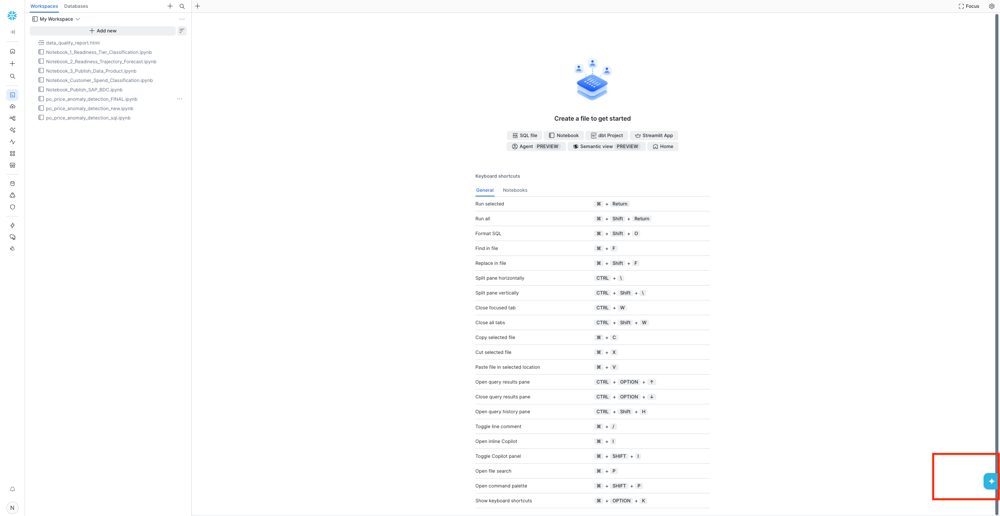
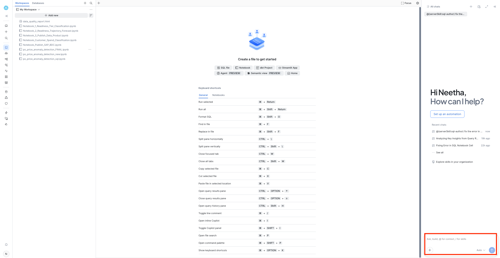

# Exercise 4- HANDS-ON: Create and publish custom derived data product in Enterprise Snowflake using CoCo Agent

We will use the CoCo agent for the creation of the data product to be published on the SAP BDC Catalog. In Snowflake, you can access CoCo as shown below. You can create a data product using prompts.

<br>

For Snowflake, we have out-of-the-box Cortex Code skills included to package and publish a custom data product. To create a data product to publish to BDC, use `/manage-zerocopy-sapbdc`. The full documentation can be found [here](https://docs.snowflake.com/en/user-guide/data-integration/zero-copy/sap-sql/publish-data)

Here is the prompt, please adjust the your name object names and the name of the data product that you want to publish:
<SCHEMA>: SCHEMA_<YOUR USERNAME>
<TABLENAME>: PO_PRICE_ANOMALY_SCORES
<SHARENAME> : TECHED_SHARE_<YOUR USERNAME>
<DATA PRODUCT NAME>: YOUR_USERNAME Purchase Order Anomaly Scores

```
/manage-zerocopy-sapbdc I have a table in TECHED_DA162.<SCHEMANAME> that I need to publish as a data product back to SAP BDC via the zerocopy connector. The table is:
<TABLENAME>
The table is already a ICERBERG VERSION=3 with the following configuration activated:
  ICEBERG_VERSION = 3
  CATALOG = 'SNOWFLAKE'
  EXTERNAL_VOLUME = 'SNOWFLAKE_MANAGED'
  STORAGE_SERIALIZATION_POLICY = 'COMPATIBLE'
  ENABLE_ICEBERG_MERGE_ON_READ = FALSE

Create a notebook that does the following:

Create a share called <SHARENAME> and grant usage on the database/schema plus SELECT on 1 Iceberg table.
Attach the share to my existing SAP BDC zerocopy connector at BROWNFIELDEU.PUBLIC.SAP_BDC_CONNECT_1789128881086. Wrap it in a BEGIN/EXCEPTION block in case the share is already associated.
Publish the data product using SYSTEM$SAP_PUBLISH_DATA_PRODUCT with a minimal CSN (version 1.0 interop, 2.0 schema). The data product should be titled "<DATA PRODUCT NAME>" with a description as follows "Enriched purchase order data with ML-driven price anomaly detection. Each record includes composite anomaly scores derived from z-score analysis across net price, order quantity, and order value dimensions. Records are classified as NORMAL, OVERPRICED, or UNDERPRICED with confidence levels ranging from 30 to 100." and a short description as follows "PO price anomaly scores with overpriced and underpriced flags." . Generate the CSN definitions block mapping each table's columns to CDS types (cds.String, cds.Decimal, cds.Timestamp), marking key and notNull fields appropriately. 
"title": "<USERNAME> Purchase Order Anomaly Scores",
"shortDescription": "PO price anomaly scores with overpriced and underpriced flags.",
"description": "Enriched purchase order data with ML-driven price anomaly detection. Each record includes composite anomaly scores derived from z-score analysis across net price, order quantity, and order value dimensions. Records are classified as NORMAL, OVERPRICED, or UNDERPRICED with confidence levels ranging from 30 to 100."

Use warehouse SYSTEM$STREAMLIT_NOTEBOOK_WH.

```

Add the above prompt edited with your personalized share name and data product name in the chat as shown below:
<br>

After running the prompt, a notebook is created with the above instructions. Click on "Keep All" to make the necessary changes.
<br>

Run the notebook to create the data product. Once done, <b>it takes about 10 minutes to publish the data product on the SAP BDC Catalog.</b>

> [!NOTE]
> In case, you have issues with generating the notebook, you can find the notebook we have provided and customize it to publish your own data product. The notebook can be found [here](./publish_to_sap_bdc.ipynb)

## Summary

You've now learnt how to create and publish a custom data product in Snowflake.

Continue to the - [Exercise 5 - Install custom data product in SAP Datasphere](../ex5/README.md) where you will learn how to install data products in SAP Datasphere.