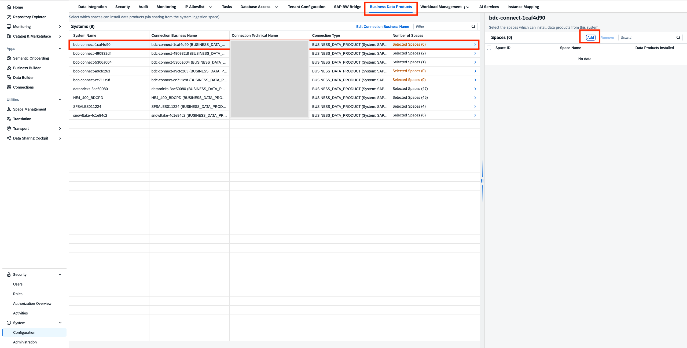
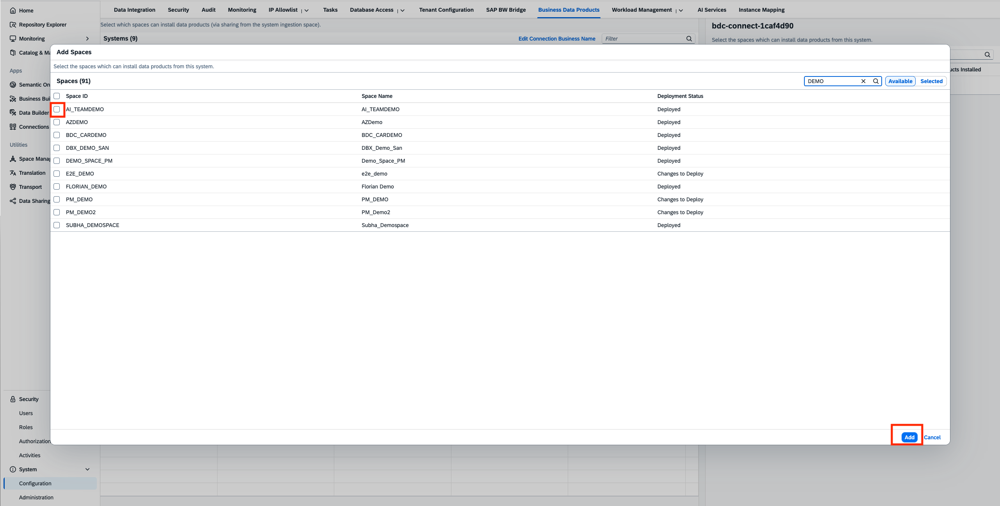
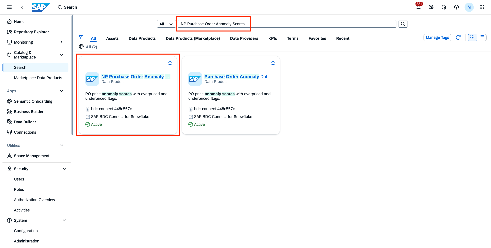
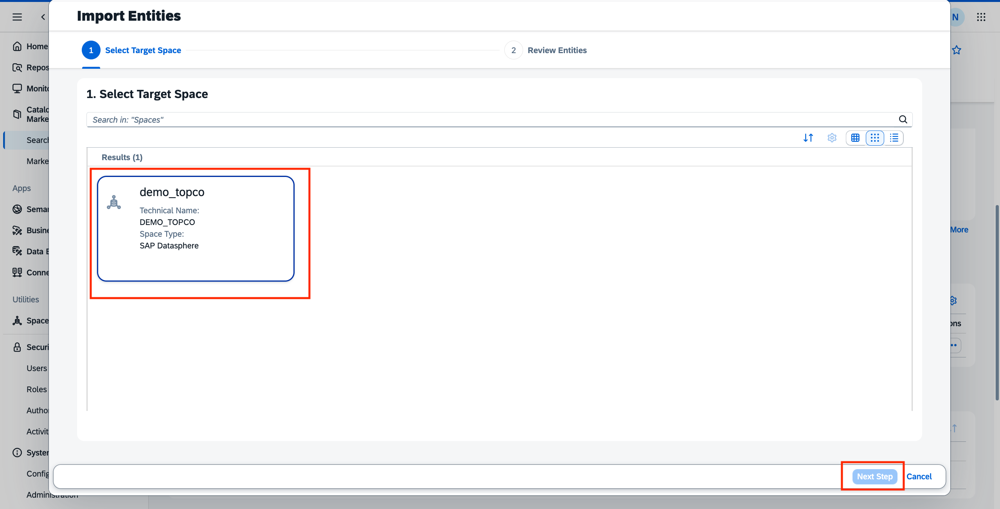
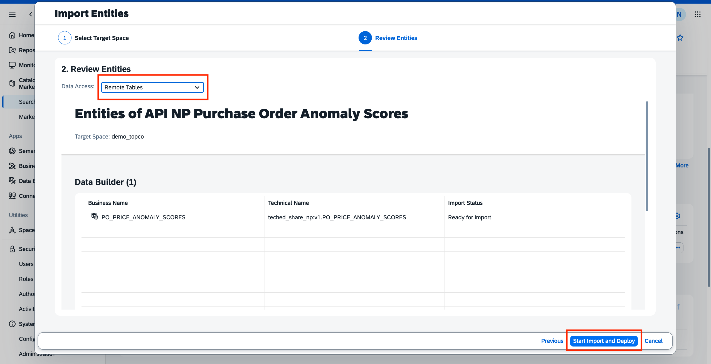
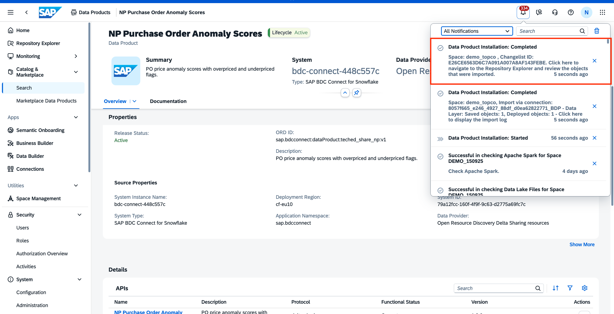
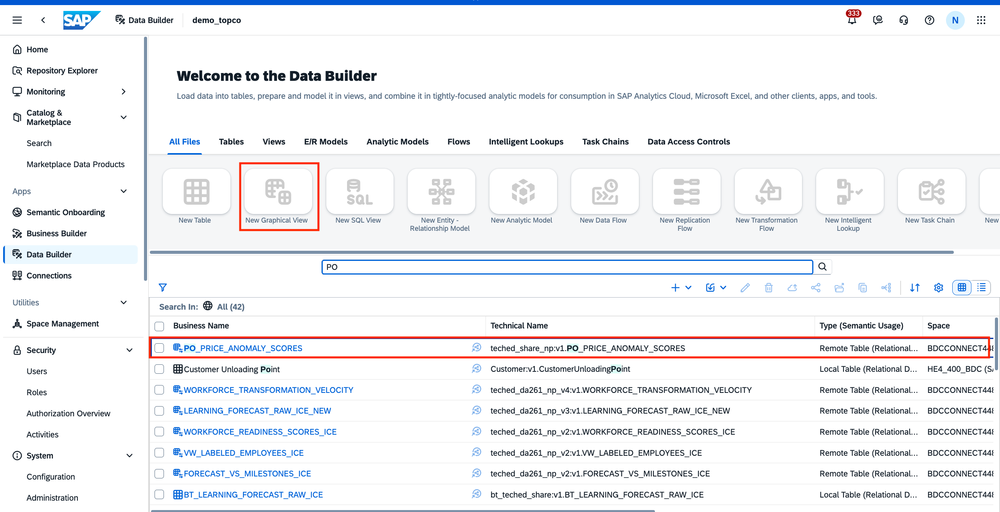
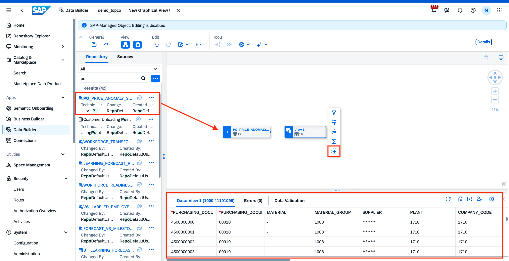

# Exercise 5 - READ_ONLY, HANDS-ON: Install custom data product in SAP Datasphere

We will now install the newly created and published data product in SAP Datasphere. This consists of two steps:

- Enable the SAP Datasphere space to receive data products
- Install the data product in your space

## Pre-requisites
- Custom space in SAP Datasphere named after your username
- Catalog role to install custom data product

## READ-ONLY: Enable SAP Datasphere space to receive Data products
Before installing the Data Product, we need to add the custom space where we want to install our required Data product to the System > Business Data Products tab and select the correct source system. Follow these steps for your custom space(consumption space) where the data product will be installed:

1. Navigate to the System menu.
2. Select the Business Data Products tab.

 

3. Add the custom space where you intend to install the Data Product.
4. Ensure that you select the correct source system for accurate integration.
 

## HANDS-ON: Install custom data product in your custom space in SAP Datasphere
In the section, we will install the new custom data product in our own space.

1. Navigate to Catalog > Search
2. Search for the data product that you have published `<USERNAME>_Purchase Order Anomaly Scores` with your user id. 
 

> [!NOTE]
> If your own data product is not yet available on the SAP BDC Catalog, we have already prepared and published a data product that can be installed in your own space.

3. Click on Install
 

4. Select space wherein you want to install the data product.

 

5. Make sure that the `Data Access` type is set to `Remote Tables`. Once done, click on **Start Import and Deploy**.
 

6. Once the data product installation is complete, you will receive a notification. 
 

7. In your custom space, you will see the data product remote table created. Create a new graphical view to view the data.
 

8. Drag and drop the table in the graphical view. View the data.
 

## Summary
The custom data product has now been successfully created and installed!