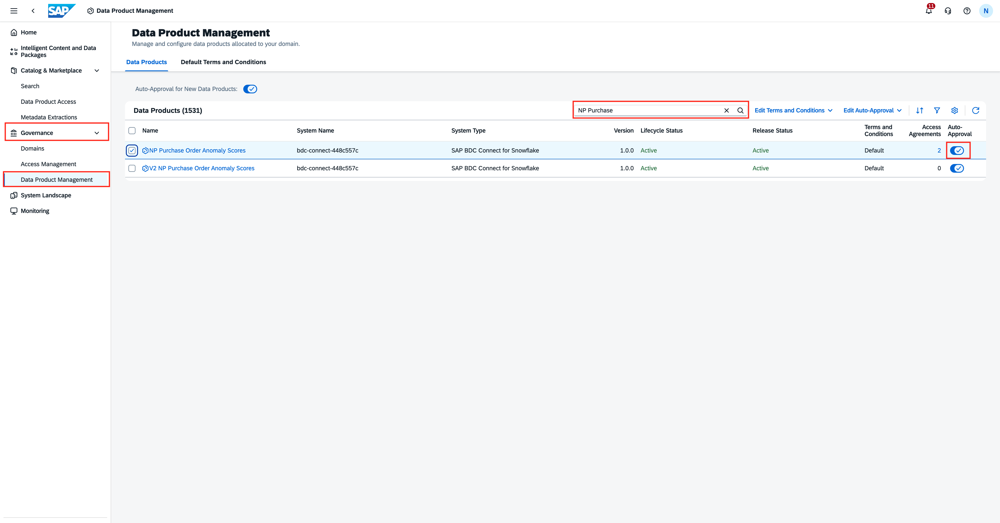
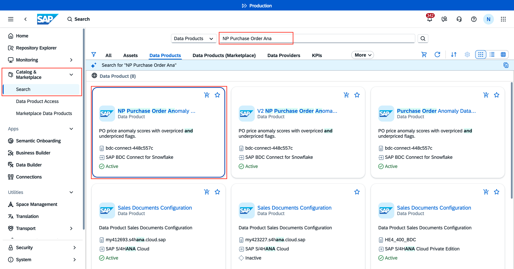
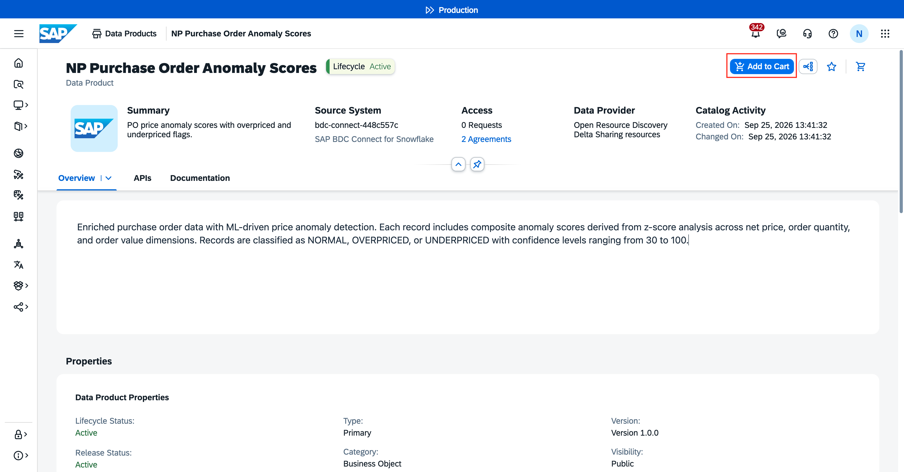
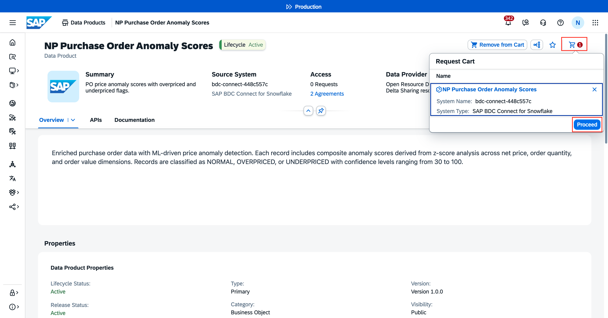
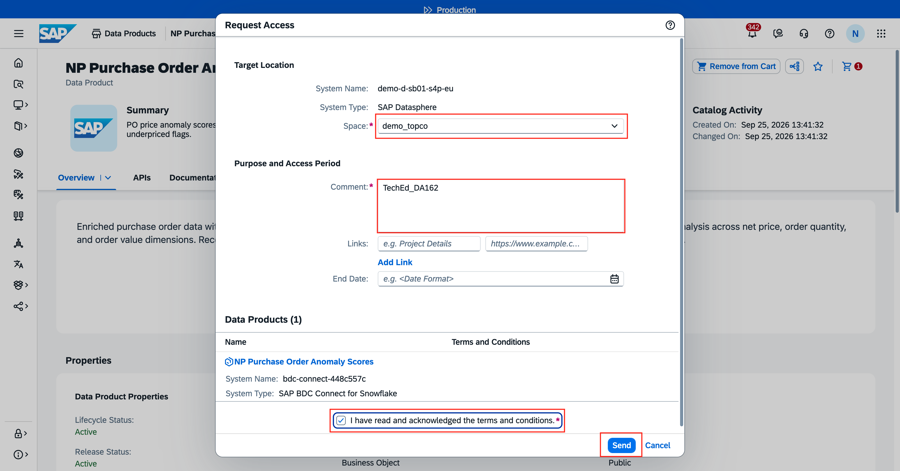
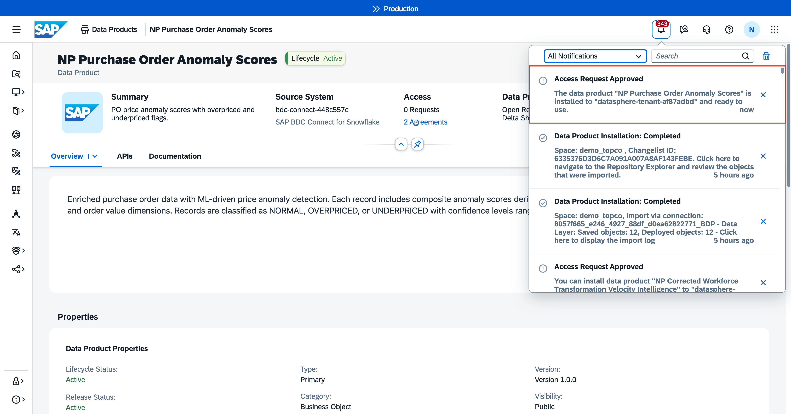
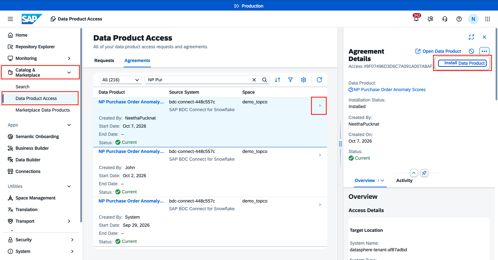
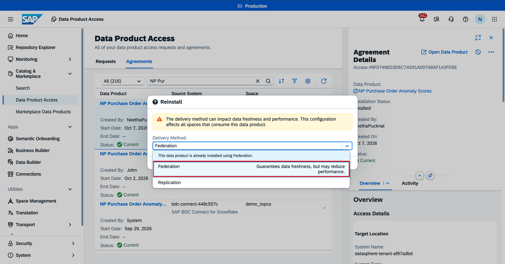
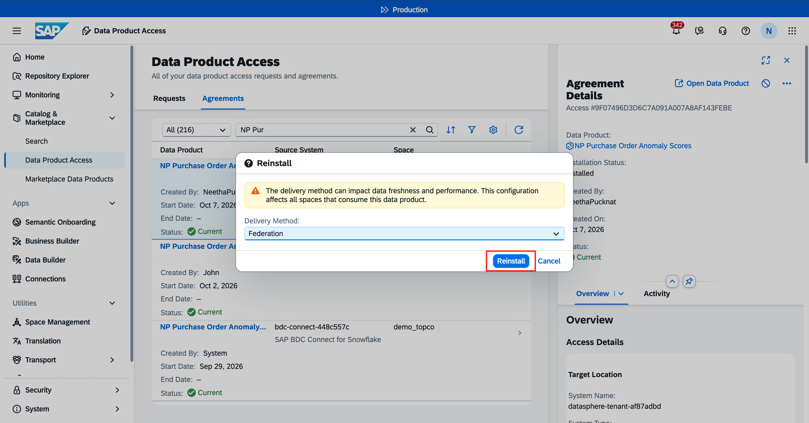
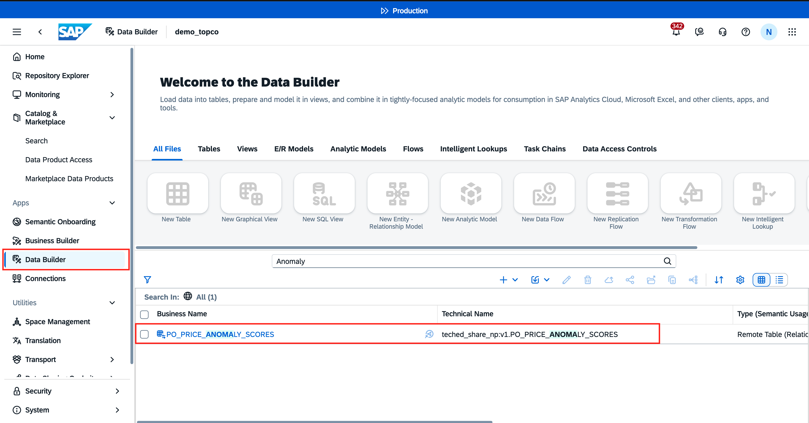

# Exercise 5 - READ-ONLY, HANDS-ON: Install custom data product in SAP Datasphere

We will now install the newly created and published data product in SAP Datasphere. 
The installation process is governed by Data product data governance. This is a new capability that will be available in SAP Business Data Cloud (SAP BDC) on wave 2026.20, released in September 2026. This new capability introduces a structured, auditable process for controlling access to data products across your organization. Rather than relying on direct permissions and manual sharing, governance shifts access management to a request-based model — one where requests are tracked, reviewed, and recorded as access agreements. to learn more about the process, you can visit this great [blog](https://community.sap.com/t5/technology-blog-posts-by-sap/data-product-data-governance-in-sap-business-data-cloud/ba-p/14470556).

## READ-ONLY: Setting up governance for this data product
For this exercise, let us proceed to install the data product that has been prepared beforehand. 
In the Governance tab, an administrator or steward can set up the rules. For our case, we have already activated auto-approval on this data product. By doing this, anyone who wants to install the data product in SAP Datasphere does not need to wait for approval.

An administrator or data steward navigates to SAP BDC Cockpit > Governance > Data Product Management. Search for the data product and then, turn the flag **Auto-Approval** on.
 

Without auto-approval enabled, the steward must manually approve each data product installation request — a workflow suited for sensitive data products or those requiring compliance oversight.

## HANDS-ON: Install Data Product in SAP Datasphere
### Access Request creation and approval
1. Navigate to SAP Datasphere.
2. Open **Catalog & Marketplace** and search for the data product `V1 Purchase Order Anomaly Scores`.
 

3. Click on **Add to Cart**.
 

4. Proceed from the cart as shown below.
 

5. Add the space name and comments. Check the Terms and Conditions checkbox after reading it. For this data product, there are no terms and conditions set up in the governance process. Then click **Send**.
 

6. The Access Request gets auto-approved.
 

### Data Product Access
1. Navigate to **Catalog & Marketplace**. Open **Data Product Access**.
2. Navigate to the Data product in question and click on **Install Data Product**.
 

3. Select the Access Type as **Federation**. 
> [!NOTE]
> **DO NOT use Replication** for this data product. Select on Federation as the data product access type.
 

4. Click **Install**.
 

5. Once the installation is complete, you can view the data product remote tables in your space assigned to you. Open **Data Builder** and navigate to the space assigned to you. You can view that the tables are now shared from the Snowflake ingestion space into your custom space.
 

## Summary
The custom data product has now been successfully created and installed!